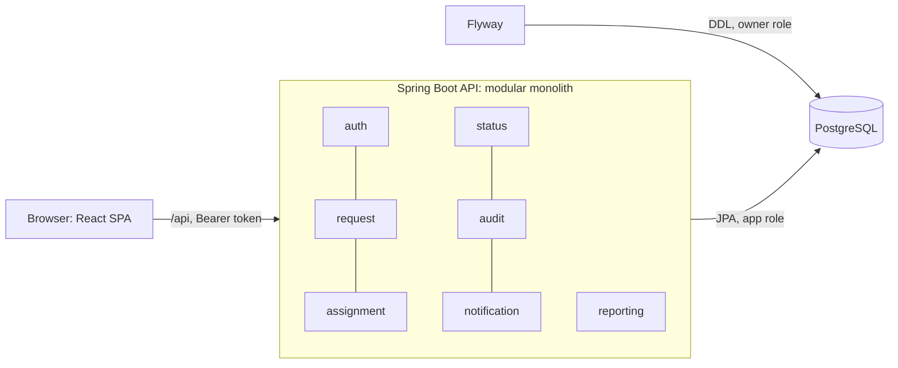

# CivicConnect

[](https://github.com/Nicholas005/SEN381-Project-CivicConnect/actions/workflows/ci.yml)
[](https://github.com/Nicholas005/SEN381-Project-CivicConnect/actions/workflows/codeql.yml)

A community service request platform built for SEN381 (Software Engineering 381) by team **Git Gud**. Requesters submit and track requests, staff work a category-scoped queue, and managers see service activity. Every status change is audited.

One repository, one product: a React frontend, a Spring Boot API and a PostgreSQL database managed by Flyway migrations.

## Contents

1. [Features](#features)
2. [Architecture](#architecture)
3. [Tech stack](#tech-stack)
4. [Repository layout](#repository-layout)
5. [Quick start (local)](#quick-start-local)
6. [Hosted database (Neon)](#hosted-database-neon)
7. [Configuration](#configuration)
8. [Demo accounts](#demo-accounts)
9. [API reference](#api-reference)
10. [Testing and CI](#testing-and-ci)
11. [Security](#security)
12. [Project status and limitations](#project-status-and-limitations)
13. [Documentation](#documentation)
14. [Team](#team)

## Features

| Role | What they can do |
|---|---|
| Requester | Submit a request with a category and description, see its stage and last update, list their history, read status messages |
| Staff | See only the categories they are authorised for, search, filter and sort the queue, open full detail, accept a request, move it through controlled steps, add internal notes, resolve, close or reject with a reason |
| Manager | See counts by status over a date range, overdue, resolved and closed requests, filter by category, average time to resolution per category |

Rules the system enforces:

- A request can only move Submitted, Assigned, In Progress, Resolved, Closed (or Submitted to Rejected). Illegal jumps are refused.
- Every status change writes an audit row in the same database transaction. If the audit write fails, the status does not change.
- Two people changing the same request at once: one wins, the other gets a 409 (optimistic locking).
- Reference numbers (`CC-` plus 8 digits) are unique, backed by a database sequence and a UNIQUE constraint.
- Requesters never see staff names or internal notes.

## Architecture



The backend is a modular monolith (ADR-M2-02): `auth`, `request`, `assignment`, `status`, `audit`, `notification`, `reporting`. Each module reaches storage through a small interface (`RequestStore`, `StatusHistoryStore`, `NotificationStore`, `UserDirectory`, `CategoryCatalog`); the `Jpa*` classes implement them for PostgreSQL and in-memory versions exist only as test doubles.

- **State pattern** for the request lifecycle (`status/`).
- **Observer** through Spring events: the audit listener runs inside the transaction, the notification listener runs after commit.
- **Ports and adapters** so the business rules are tested without a database.
- **Least-privilege database roles**: the owner role runs migrations, the app role has data access only (no DELETE on requests, no UPDATE on history), a read-only role sees a reporting view.

In the container build, the API serves the built React app, so the browser and the API share one origin.

## Tech stack

| Layer | Technology |
|---|---|
| Frontend | React 18, TypeScript, Vite, Tailwind CSS 4 |
| Backend | Java 21, Spring Boot 4.1, Spring Data JPA (Hibernate), Spring Security (stateless), Maven wrapper |
| Authentication | Signed JWT (HS256), BCrypt password hashes |
| Database | PostgreSQL 15+, Flyway migrations V1 to V3 |
| Tests | JUnit 5, ArchUnit, JaCoCo, Vitest, Playwright, k6 |
| Delivery | Docker (multi-stage image), GitHub Actions, CodeQL, Dependabot |

## Repository layout

```
civicconnect/
├── backend/            Spring Boot API (src/main, src/test, pom.xml)
├── frontend/           React app, unit tests and browser tests
├── db/00_roles.sql     database roles: owner, app, read-only
├── docker/init/        first-start script that applies the roles locally
├── docker-compose.yml  PostgreSQL, and the whole app with the "full" profile
├── Dockerfile          builds the React app and the API into one image
├── docs/               Milestone 2 document, test traceability
├── tests/              k6 performance script
├── scripts/            test-all.sh / test-all.ps1, git hook installer, CI helpers
├── .github/            CI, CodeQL, dependency review, Dependabot, PR template
└── .env.example        copy to .env
```

## Quick start (local)

Requirements: Docker, JDK 21, Node 20 or newer (22 recommended).

```bash
cp .env.example .env            # choose your own values; letters and digits only for DB_* passwords
docker compose up -d db         # PostgreSQL on localhost:5433, roles created on first start
```

Backend (new terminal):

```bash
cd backend
./mvnw spring-boot:run          # Windows: mvnw.cmd spring-boot:run
```

Frontend (new terminal):

```bash
cd frontend
npm install
npm run dev                     # http://localhost:5173, proxies /api to :8080
```

Flyway runs the migrations as `civicconnect_owner`; the API then connects as `civicconnect_app`. With the default `dev` profile the demo data is loaded too.

Everything in containers instead:

```bash
docker compose --profile full up -d --build     # http://localhost:8080
```

To start clean: `docker compose down -v`.

## Hosted database (Neon)

The team's hosted database is a [Neon](https://neon.com) PostgreSQL project (`Civicconnect`, branch `production`, AWS Europe West 2 London, free plan). Neon hosts the database only; the API and frontend run wherever you run the container image.

The connection details are in the Neon console under **Connect** (choose the branch, database and role). **Never commit them.** They go in your untracked `.env` or the hosting platform's secret store.

### One-time setup

Neon creates the owner role and the database for you. The application still needs its own two roles, because `V1__init_schema.sql` grants privileges to them by name.

1. In the Neon **SQL Editor**, connected as the owner role, create the roles and give them access (use your own passwords, letters and digits only):

   ```sql
   CREATE ROLE civicconnect_app      LOGIN PASSWORD '<app password>'      NOSUPERUSER NOCREATEDB NOCREATEROLE;
   CREATE ROLE civicconnect_readonly LOGIN PASSWORD '<readonly password>' NOSUPERUSER NOCREATEDB NOCREATEROLE;
   GRANT USAGE ON SCHEMA public TO civicconnect_app, civicconnect_readonly;
   ```

   Role and database names in Neon are case-sensitive. Use the owner and database names exactly as the console shows them (here `Civicconnect_owner` and `Civicconnect`). The two roles above must be lowercase because the migrations refer to them unquoted.

2. Set the variables below, using the **direct** connection (not the pooled one, which Flyway should not use):

   ```bash
   DB_HOST=ep-xxxxxxxx.c-2.eu-west-2.aws.neon.tech
   DB_PORT=5432
   DB_NAME=Civicconnect
   DB_URL_PARAMS=?sslmode=require
   DB_OWNER_USER=Civicconnect_owner
   DB_OWNER_PASSWORD=<owner password from the Neon console>
   DB_APP_USER=civicconnect_app
   DB_APP_PASSWORD=<app password>
   APP_AUTH_SECRET=<at least 32 random characters>
   APP_CORS_ALLOWED_ORIGINS=https://<where the frontend is served>
   SPRING_PROFILES_ACTIVE=prod
   ```

3. Start the API. Flyway applies V1 to V3 as the owner role on first start, then the API connects as `civicconnect_app`.

   ```bash
   docker build -t civicconnect --build-arg VITE_SHOW_DEMO_ACCOUNTS=false .
   docker run --rm -p 8080:8080 --env-file .env civicconnect
   ```

   Or without Docker: `cd backend && ./mvnw spring-boot:run` with the same variables set.

### Things to know about the free plan

- The compute scales to zero when idle, so the first request after a quiet period is slow (cold start).
- Free-plan limits apply to compute hours and storage. Running the load test uses compute hours.
- Use `SPRING_PROFILES_ACTIVE=prod`. The `dev` profile loads demo accounts that share one known password and must never run against the hosted database.
- Keep the owner password out of the application's runtime configuration where you can. It is only needed for migrations; a deployment that only needs the app role should run migrations as a separate step.
- If a connection string was ever pasted into a chat, an issue or a screenshot, reset the password in the Neon console (**Reset password** next to the role) and update your secrets.

## Configuration

All settings are environment variables. Values in `.env` are read automatically.

| Variable | Default | Purpose |
|---|---|---|
| `SPRING_PROFILES_ACTIVE` | `dev` | `dev` loads demo data; `prod` loads reference data only |
| `DB_HOST`, `DB_PORT`, `DB_NAME` | `localhost`, `5433`, `civicconnect` | Database location |
| `DB_URL_PARAMS` | empty | Extra JDBC parameters, for example `?sslmode=require` for Neon |
| `DB_OWNER_USER`, `DB_OWNER_PASSWORD` | `civicconnect_owner`, none | Role that runs Flyway migrations |
| `DB_APP_USER`, `DB_APP_PASSWORD` | `civicconnect_app`, none | Role the running API uses |
| `DB_ADMIN_PASSWORD`, `DB_READONLY_PASSWORD` | none | Local Docker database only |
| `APP_AUTH_SECRET` | none | Signs login tokens. At least 32 characters. The API will not start without it |
| `APP_AUTH_TOKEN_TTL_MINUTES` | `480` | Token lifetime |
| `APP_CORS_ALLOWED_ORIGINS` | `http://localhost:5173` | Browser origins allowed when the frontend is hosted separately |
| `PORT` | `8080` | API port |

Generate a secret with `openssl rand -base64 48 | tr -dc 'A-Za-z0-9'`.

Frontend build options (`frontend/.env`): `VITE_USE_MOCK` (use the built-in mock API, no backend needed), `VITE_SHOW_DEMO_ACCOUNTS`, `VITE_API_BASE_URL`, `VITE_DEV_PROXY_TARGET`.

## Demo accounts

Only in the `dev` profile. All use the password `Test@1234`.

| Role | Email | Sees |
|---|---|---|
| Requester | `req1@civicconnect.test` to `req5@civicconnect.test` | their own requests and notifications |
| Staff | `staff1@civicconnect.test` | IT support, Maintenance |
| Staff | `staff2@civicconnect.test` | Facility fault, Damaged equipment, Security concern |
| Staff | `staff3@civicconnect.test` | Lost property, Other, IT support |
| Manager | `manager@civicconnect.test` | reports and dashboard |

People can register in the app; registration always creates a requester. Staff and manager accounts are provisioned in the database by an administrator.

## API reference

The browser calls `/api/*` with `Authorization: Bearer <token>`. Errors are `{ "message": "..." }` with status 400, 401, 403, 404 or 409.

| Endpoint | Who | Purpose |
|---|---|---|
| `POST /api/auth/login`, `POST /api/auth/register` | public | returns `{ token, user }` |
| `GET /api/health` | public | liveness check |
| `GET /api/users/me`, `GET /api/categories` | signed in | profile, category list |
| `POST /api/requests` | requester | submit (201 with a Location header) |
| `GET /api/requests/mine` | requester | own requests |
| `GET /api/requests?search&status&categoryId&sort` | staff | category-scoped queue |
| `GET /api/requests/{id}` | owner or staff in scope | detail with history; staff also see internal notes |
| `POST /api/requests/{id}/assign` `{version}` | staff | accept responsibility |
| `POST /api/requests/{id}/status` `{targetStatus, comment, version}` | staff | start, resolve, close or reject |
| `POST /api/requests/{id}/comments` `{comment, version}` | staff | internal note |
| `GET /api/notifications`, `POST /api/notifications/{id}/read` | requester | in-app messages |
| `GET /api/reports/summary?from&to&categoryId` | manager | dashboard data |

A 409 means someone else changed the request first, or the move is not allowed.

## Testing and CI

Everything is automated. `.github/workflows/ci.yml` runs on every push and pull request and nightly. It builds and tests the backend against PostgreSQL 15, builds and tests the frontend, and then drives the running system with a browser. CodeQL and dependency review run on pull requests; Dependabot keeps dependencies current.

| Layer | Command | Needs |
|---|---|---|
| Backend unit and architecture tests | `cd backend && ./mvnw test` | nothing |
| Backend plus API tests on PostgreSQL, JaCoCo report | `cd backend && ./mvnw verify` | `docker compose up -d db` |
| Frontend unit tests | `cd frontend && npm test` | nothing |
| Browser tests (mock API) | `cd frontend && npm run test:e2e` | nothing |
| Everything, throwaway database | `scripts/test-all.sh` or `scripts\test-all.ps1` | Docker |
| Load test P-01 | `k6 run tests/performance/submit.js` | k6 and a running API |

`scripts/install-git-hooks.sh` adds an optional pre-push check. `docs/TEST_TRACEABILITY.md` maps every test to its requirement and PED test ID (T-, A-, E-, P-). `tests/README.md` explains the layout.

The integration tests skip on a developer machine when no database is reachable, and fail when the `CI` variable is set, so a pipeline cannot go green without them.

## Security

- Passwords are stored as BCrypt hashes. Tokens are stateless and signed; the API refuses to start without a strong `APP_AUTH_SECRET`.
- Every `/api/**` endpoint requires a token except login, registration and health. Roles and category scope are enforced on the server.
- The database enforces append-only history and notes, and the app role cannot alter or delete audit rows.
- Secrets live in `.env` (gitignored) or the platform's secret store, never in the repository. `db/00_roles.sql` holds only `CHANGE_ME_*` placeholders.
- Run the hosted build with `SPRING_PROFILES_ACTIVE=prod` and `VITE_SHOW_DEMO_ACCOUNTS=false`.
- An earlier version of `db/00_roles.sql` had real passwords in the repository history. Treat those as compromised and rotate every database role password wherever they were used.

Report a vulnerability to the team privately rather than in a public issue.

## Project status and limitations

All 16 functional requirements from the M1 baseline are implemented. The build is intended for demonstration and staging, not for production use with real requesters. Known limitations:

- No login rate limiting, and tokens cannot be revoked before they expire.
- The default profile is `dev`; production deployments must set `SPRING_PROFILES_ACTIVE=prod` explicitly.
- Overdue thresholds are placeholders (72 hours by default) until agreed with the sponsor.
- Notifications are in-app only. Managers can view reports but have no screen for acting on requests.
- Uptime, usability and load targets (NFR-001, NFR-004, NFR-005) have not been measured.
- No backup and restore has been rehearsed. Take a `pg_dump` before deploying a build with a new migration.

The full scope table, completion percentage, defect register and go-live decision are in **PED v4.0**.

## Documentation

- Project Engineering Document (PED v4.0): scope, requirements, architecture decisions, registers, RTM
- `docs/TEST_TRACEABILITY.md`: tests mapped to requirements
- `tests/README.md`: test layout
- `frontend/GUIDE.md`: frontend notes

## Team

Git Gud, SEN381 Software Engineering 381.

| Name | Role |
|---|---|
| Rivan Maritz | Data and Security Lead |
| Nicholas Armin Vronka | Web App Lead |
| Michiel Coenraad TerBlanche | Java App Lead |

This is an academic project. No licence is granted unless one is added to the repository.
